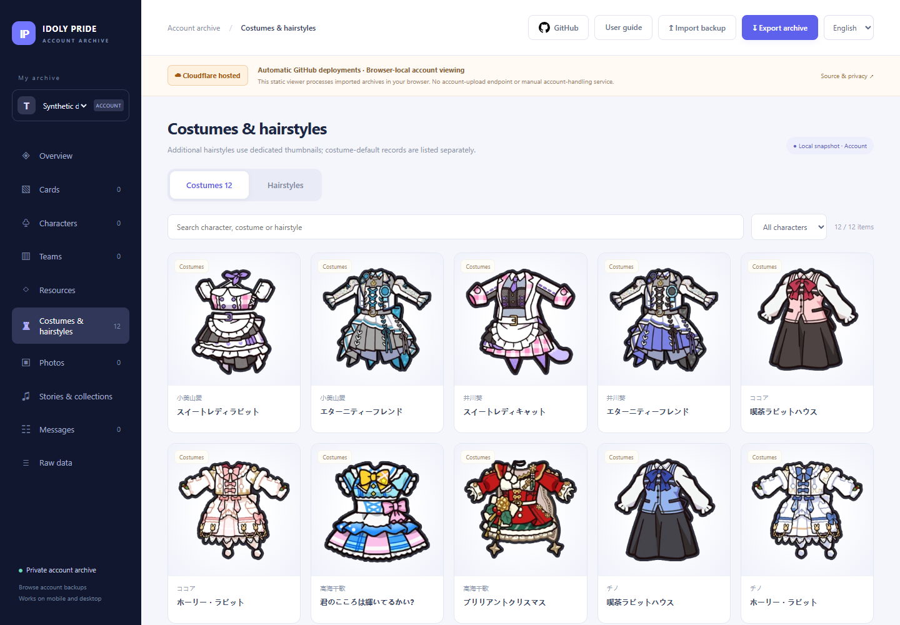
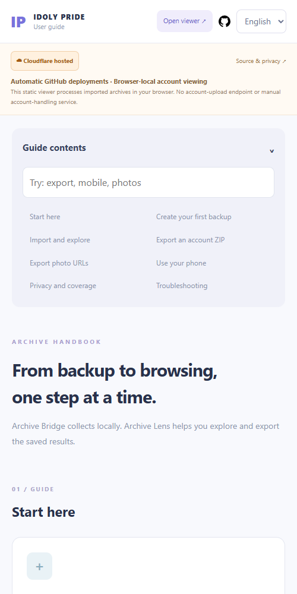

# Archive Lens

[](https://archive-lens.chiyoda-site.workers.dev/)

[](https://archive-lens.chiyoda-site.workers.dev/)  

[English](README.md) · [Simplified Chinese](README.zh-CN.md) · [Japanese](README.ja.md) · [Korean](README.ko.md)

> **Cloudflare-hosted static viewer · Automatic GitHub deployments · No manual account handling.**
>
> Your IDOLY PRIDE archive, easy to explore. Import a backup locally, browse its saved content, and export it again on desktop or mobile.

**[Open the viewer](https://archive-lens.chiyoda-site.workers.dev/)** · **[User guide](https://archive-lens.chiyoda-site.workers.dev/guide/)** · **[Get Archive Bridge](https://github.com/Nagisa0803/archive-bridge/releases)**

[Preview](#preview) · [Features](#features) · [Quick start](#quick-start) · [Deployment](#deployment) · [Privacy & limits](#privacy--limits)

## Preview

<p align="center">
  
  
</p>

*Gallery preview uses explicit online-thumbnail opt-in; the default uses bundled images only. Screenshots use a fictional demo and generic game thumbnails. No real account, ownership data, credentials or private photo links are published.*

## Features

| Explore | What you can do |
| --- | --- |
| Cards & characters | Browse saved cards; open a character to see all their owned cards, then inspect a card. Artwork appears when included in the backup. |
| Teams & resources | Inspect saved formations, inventory and original account records. |
| Costumes & hairstyles | Search thumbnails, filter by character and enlarge previews. Additional hairstyles and costume-default records stay separate. |
| Photos | Export available original/thumbnail URL mappings as JSON, CSV or TXT; import matching supplemental link JSON. |
| Portable archives | Import ZIP or User/Get JSON and re-export ZIP with saved data and available media. |
| Desktop & mobile | Switch between English, Chinese, Japanese and Korean. English is the default; the searchable handbook explains each step. |

## Quick start

1. **Collect locally:** download [Archive Bridge](https://github.com/Nagisa0803/archive-bridge/releases), run its local wizard and save your ZIP. The collector handles explicitly authorized authentication and necessary reads on your computer.
2. **Import privately:** open [Archive Lens](https://archive-lens.chiyoda-site.workers.dev/) on your computer or phone and choose **Import backup**. The viewer does not ask for your game password.
3. **Explore and keep a copy:** browse the saved content or choose **Export archive**. Keep the original ZIP; refreshing the page clears the current imported session.

[Archive Bridge](https://github.com/Nagisa0803/archive-bridge) collects; **Archive Lens** views and exports. The public viewer does not run the collector backend or upload your account to it. See the [handbook](https://archive-lens.chiyoda-site.workers.dev/guide/) for the full walkthrough.

## Deployment

The live site uses **Cloudflare Workers static hosting**, automatically deployed from GitHub. These statements describe this build; hosting does not prevent maintainers from updating its public source. For **Cloudflare Pages**, connect this repository and use:

| Setting | Value |
| --- | --- |
| Framework / production branch | None / `main` |
| Root directory | Repository root |
| Build command | `npm run build` |
| Output directory | `public` |
| Game credentials / secrets | None |

To preview locally, use Node.js 22+; no npm dependencies are required:

```sh
npm run build
npm run dev
```

Open `http://127.0.0.1:8793/` or `/guide/`. Add `?lang=en`, `zh`, `ja` or `ko` to select a language. Build restores the complete generic WebP thumbnail set from the checked-in asset packs; it does not download game resources. See [DEPLOY.md](DEPLOY.md) for more deployment details.

## Privacy & limits

- **Local processing:** imported files stay in the current browser session. No account POST upload, localStorage or IndexedDB persistence; refreshing clears the imported state. Generic metadata still loads from Cloudflare. Online item thumbnails are **off by default**; enabling them can reveal viewed items through hosting logs. Opening a photo link contacts its provider.
- **Public source only:** the repository contains generic code, definitions and thumbnails. Never commit real snapshots, ownership sets, private photo URLs, ZIPs, device data, passwords, authentication tokens or TLS keys.
- **Private full backups:** re-export preserves imported fields, raw protobuf and extra attachments. They may contain credentials or personal data; `credentialsIncluded` is unknown, not a credential-free guarantee. Keep these ZIPs private; no sanitized sharing mode is claimed.
- **Honest coverage:** a saved User/Get response does not prove complete photo-original, message, phone or other independent-history coverage. Missing links are not guessed. URL export is not a full photo backup, and ZIP import does not restore an account into the official game.
- **Import limits:** 128 MiB per archive and unpacked total; 64 MiB per member. Interface language changes do not translate or alter original game records.

[Third-party notices](THIRD_PARTY_NOTICES.md) · [Collector source](https://github.com/Nagisa0803/archive-bridge) · [Report an issue](https://github.com/Nagisa0803/archive-lens/issues)

Game names, trademarks and assets belong to their respective rights holders. This project is not affiliated with the game publisher.
